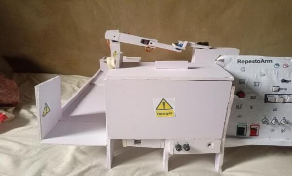
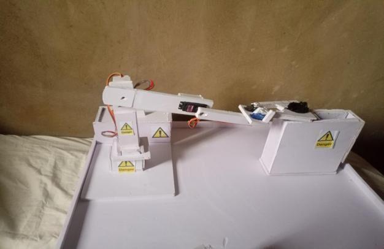
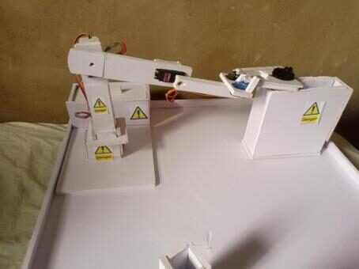
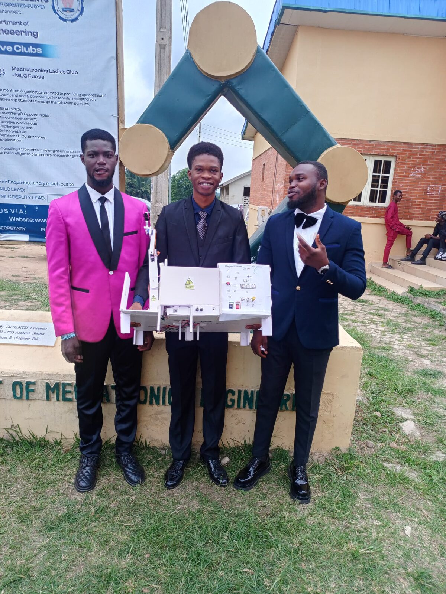
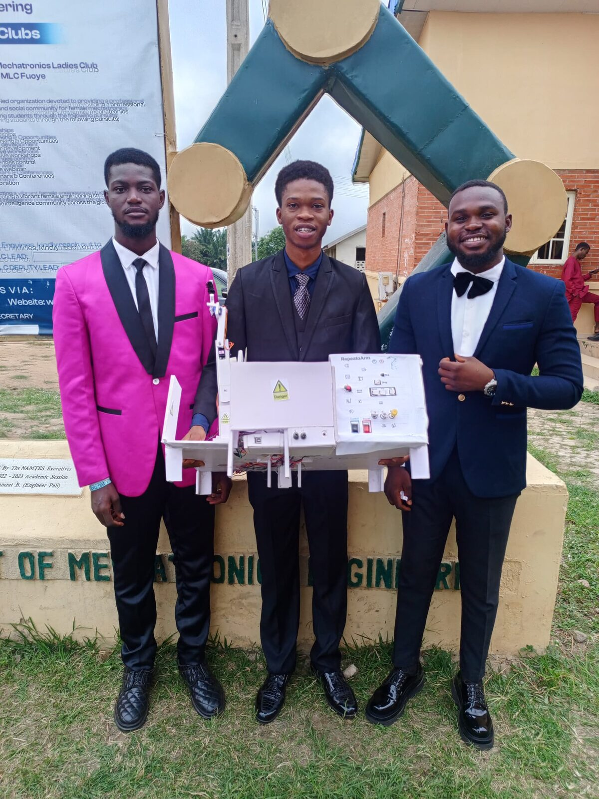
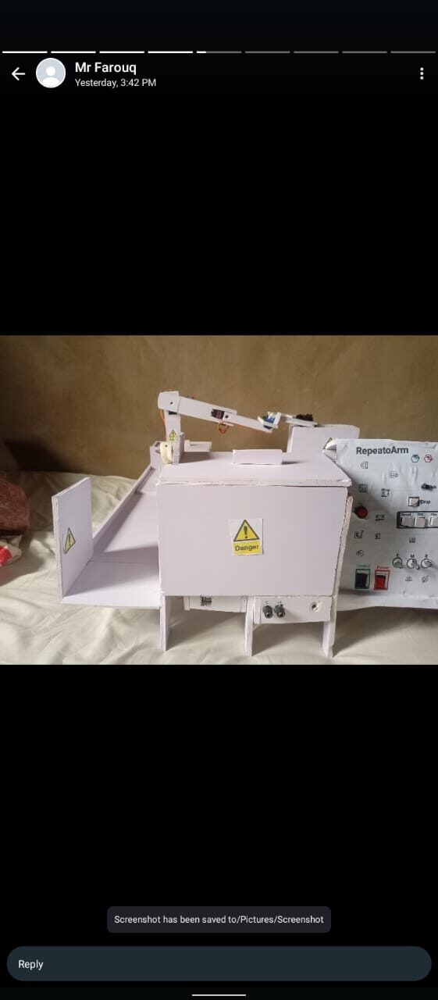
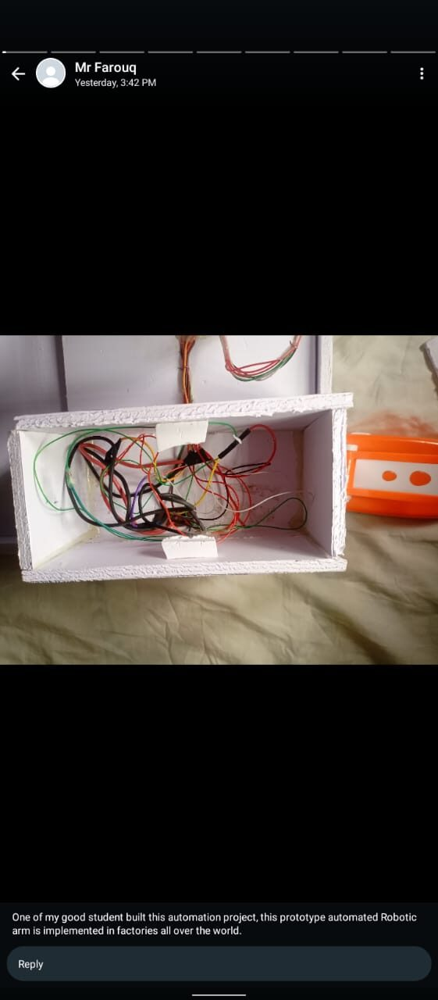
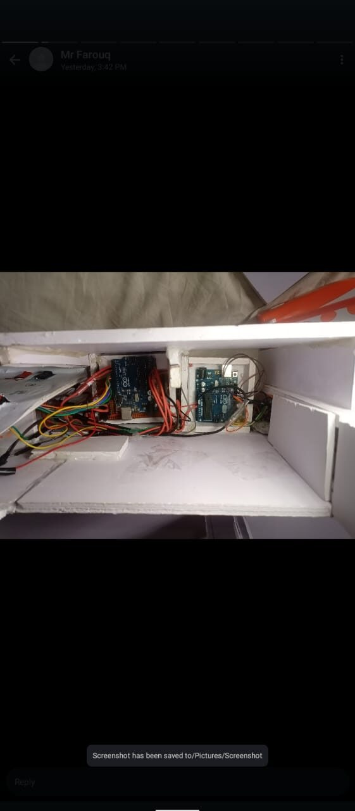

# RepeatoArm

**A foam-board robotic arm I taught to repeat itself.**  

*2023–2024 · Final-year Mechatronics Engineering project · Federal University Oye-Ekiti*

I built this arm from foam board, three MG996R servos for the joints and two SG90 servos for the claw. You pose it with three potentiometers, press a button to save each pose, and press play. It then repeats the sequence over and over until it is reset or switched off. A second Arduino with an ultrasonic sensor runs a separate proximity alarm.

▶ **[Watch me introduce the project, demonstrate it live and answer questions](https://youtu.be/JiwwPDpY4y4)**

<table><tr><td align="center" width="33%"> Front view</td><td align="center" width="33%"> Side view</td><td align="center" width="33%"> Top view</td></tr></table>

| | |
|---|---|
| **What it is** | A teach-and-repeat robotic arm, plus a separate proximity alarm |
| **How it moves** | 3 × MG996R joints driven by potentiometers, 2 × SG90 claw servos |
| **How you teach it** | Save up to 10 poses (claw state included). I used 8–9 while testing |
| **What it carried** | A 27 g PET bottle (manufacturer's figure), tower to stand, about 6 replay cycles on video |
| **Controllers** | 2 × Arduino Uno: one for the arm, one for the alarm |
| **Alarm** | HC-SR04 ultrasonic sensor, triggers under 50 cm, 4 LEDs and a buzzer, resets after 5 s or on a button |
| **My part** | I designed, built, programmed and demonstrated it. Two teammates funded it and learned alongside me while I guided them |
| **Status** | Works as demonstrated. Positional accuracy has **not** been measured yet (see below) |

## Where this started

   
  <em>Me building and fixing the first robotic arm, controlled by potentiometers and push buttons only</em>

This project started when I was building and fixing a robotic arm that was controlled only by potentiometers and push buttons. It had no recording and no security.

RepeatoArm keeps that control scheme and adds two things: **record-and-replay** of the arm's poses, and a **separate proximity alarm**.

## What it does

1. Move the three potentiometers to pose the arm. Two buttons open and close the claw.
2. Press **record**, then press **save** at each pose you want to keep (up to 10, claw state included).
3. Press **play**. The arm moves joint by joint, one degree every 30 ms, returns to the first pose, and repeats.
4. To stop it I pressed the Arduino's reset button or switched it off. Reset also clears the recording.

In the demonstration it carried a PET bottle from a tall tower to a short stand. The bottle's wide cap rests on the claw, which is why it was held securely even though the clamping force felt marginal. Details: [how the firmware works](docs/firmware.md).

## How I built it

The structure is foam board with servos mounted directly on it. The full parts list is in [hardware/bill_of_materials.md](hardware/bill_of_materials.md); the story of the build is in [docs/build-story.md](docs/build-story.md).

   
  <em>The materials I gathered for the build</em>

   
  <em>Servos mounted on foam board, an early stage of the arm</em>

   
  <em>Assembling the arm with its control buttons</em>

   
  <em>A box I made for the Arduino Uno</em>

   
  <em>The workspace and the alarm system, finished before I built the arm</em>

   
  <em>The alarm stand and ultrasonic sensor, nearly done</em>

   
  <em>Wiring the connections after assembly</em>

## The electronics

The arm and the alarm are two separate Arduino circuits that share a workspace. Pin tables, the block diagram and the power layout are in [docs/hardware](docs/hardware/).

   
  <em>Circuit diagram of the security alarm: HC-SR04, LEDs and buzzer (resistor labels in the drawing are placeholders; the LEDs ran on 1 kΩ)</em>

   
  <em>Veroboard with header pins for the Nano. I soldered the headers and wires first so nothing had to be soldered onto the Nano itself</em>

**Power.** I used separate chargers for the servo groups and the Arduinos, with a common ground. The exact split between chargers, and how the third MG996R was supplied from 12 V, were not recorded, so they are listed as open items in [docs/hardware/power.md](docs/hardware/power.md) and not guessed.

## When things broke

**The Nano.** While I was debugging, a wire was put in the wrong hole and destroyed the Nano that ran the arm. There was no spare Nano, so I rebuilt the arm controller on an Uno under deadline pressure. I had planned a Nano for the arm and an Uno for the alarm, and ended with an Uno for each.

**Power.** Early on, the servos and boards were fighting for power. I split the loads across separate supplies and added a control switch and a power switch.

**The stop button.** Replay is a blocking loop that reads the stop button once per cycle, so a quick press during movement is missed. I stopped it with reset or by switching it off. It is a real design limitation and it is written up in [docs/failures.md](docs/failures.md).

   
  <em>▶ Testing that the potentiometers drive the servos (the arm was not picking yet)</em>

   
  <em>▶ All-round test: everything working</em>

## The maths behind it

These are **calculated**, not measured. Link lengths are my own ruler measurements (shoulder height 13.5 cm, upper arm 15 cm, forearm and closed claw 15 cm). Pick and drop positions are reconstructed from my demo video to about ±3 cm, because the arm was dismantled after submission.

- **Reach:** 30 cm from the shoulder axis, about 27–28 cm along the board at pick height. The 60 × 60 cm figure is the board, not the reach. [01](docs/calculations/01_reach_and_workspace.md)
- **Joint angles:** solved three independent ways (law of cosines, circle intersection, numerical Jacobian) and checked with forward kinematics. The methods agree, and the drop pose is well inside reach while the pick is close to full stretch. [02](docs/calculations/02_inverse_kinematics_pick_drop.md)
- **Payload:** about 111–138 g as a smooth working load at full stretch, and 268–321 g as the stall limit, from datasheet torque, before counting the foam links. The bottle I used weighs 27 g. [03](docs/calculations/03_payload_and_torque.md)
- **Resolution:** one degree of joint error moves the tip about 0.5 cm at full reach. [04](docs/calculations/04_resolution_and_tip_error.md)

After submission I re-checked the kinematics with these methods and corrected my earlier hand-worked example. Both are documented in [docs/change-log.md](docs/change-log.md).

## What I tested, and what I haven't

| Feature | Status |
|---|---|
| Record and replay of up to 10 poses | Demonstrated on video |
| Picking and dropping a 27 g bottle | Demonstrated on video, about 6 cycles |
| Proximity alarm (50 cm, 5 s auto-reset) | Built and working in the project; no measurement data in this repository |
| Positional accuracy and repeatability | **Not measured.** A [test procedure](docs/repeatability-test.md) is included |
| Payload | Calculated only; demonstrated with 27 g |
| Emergency stop, collision avoidance | **Not implemented** |
| On-board inverse kinematics, machine learning | **Not implemented.** "Learning" here means the arm stores poses and plays them back |

Everything is traced to evidence in the [evidence matrix](docs/evidence-matrix.md) and the [test records](docs/testing.md).

## Limits, and what I would do next

**Limits**
- Poses live in RAM, so reset or power-off erases them.
- Joints move one after another, so the path between poses is not a straight line.
- No position feedback, and no force limit on the claw.
- Servos share chargers without fuses.
- The foam links flex; I did not measure how much.

**Next**
- Store poses in EEPROM and move several joints at once with interpolation.
- Add a hardware emergency stop and let the alarm pause the arm.
- Measure repeatability with the procedure in the repo.
- Stiffer links and a gripper with a measured jaw range.

More in [docs/limitations.md](docs/limitations.md), [docs/technical-debt.md](docs/technical-debt.md) and [docs/future-work.md](docs/future-work.md).

## People

I designed, built, programmed and demonstrated RepeatoArm. My two teammates, Ahmed Smatt Adeniyi and Akinrodoye Abimola Akinsanmi, contributed financially and learned alongside me while I guided them through the build. My supervisor was Dr. M. O. Arowolo.

   
  <em>With my team</em>

### Defense day

   
  <em>Defense day</em>

### My instructor's posts

<table><tr><td align="center" width="33%"> Posts by my instructor featuring the project</td><td align="center" width="33%"> Posts by my instructor featuring the project</td><td align="center" width="33%"> Posts by my instructor featuring the project</td></tr></table>

## What is in this repository

| Folder | Contents |
|---|---|
| `firmware/` | The two Arduino sketches (arm controller and alarm) |
| `hardware/` | Bill of materials |
| `docs/hardware/` | Pin tables, block diagram, power layout |
| `docs/calculations/` | Reach, kinematics, payload and resolution, with full working |
| `calculations/` | Python scripts that reproduce every number, and their outputs |
| `docs/` | Build story, firmware notes, testing, evidence matrix, failures, design decisions, limitations, references |
| `media/` | Photos, circuit diagrams and the hero GIF (videos are on YouTube) |

**To rebuild it:** wire the two circuits from the pin tables, install the Arduino `Servo` library, and flash the two sketches.
Not recorded, so it cannot be reproduced exactly: which servo is which joint and its zero position, the jaw gap, the foam link weights, and the exact power split.

---

Author: Olalekan Olamide · GitHub [@velrite](https://github.com/velrite)  

Licence: [MIT](LICENSE).
