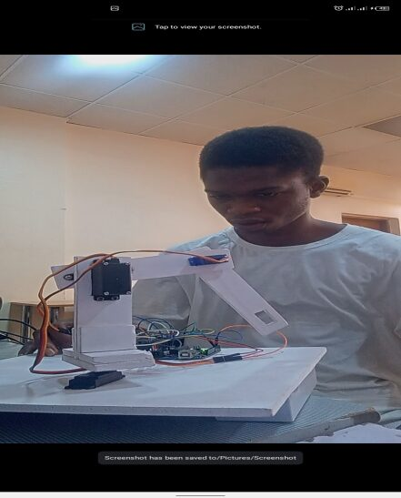
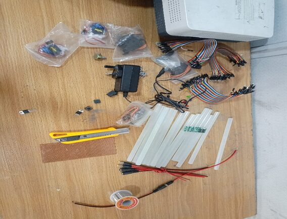
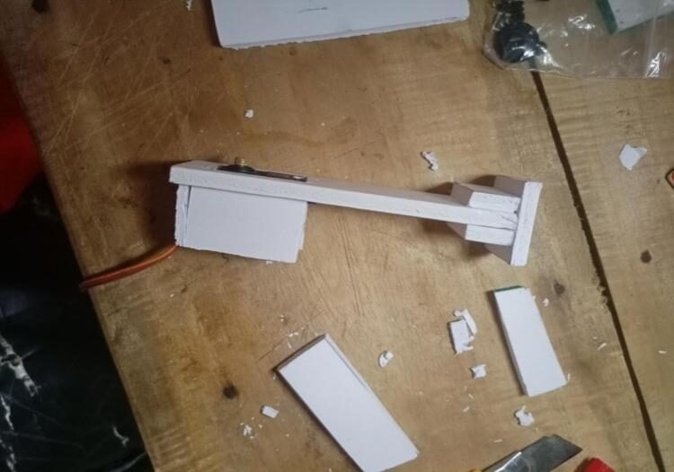
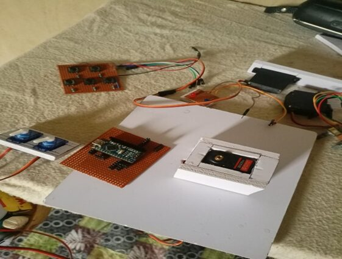
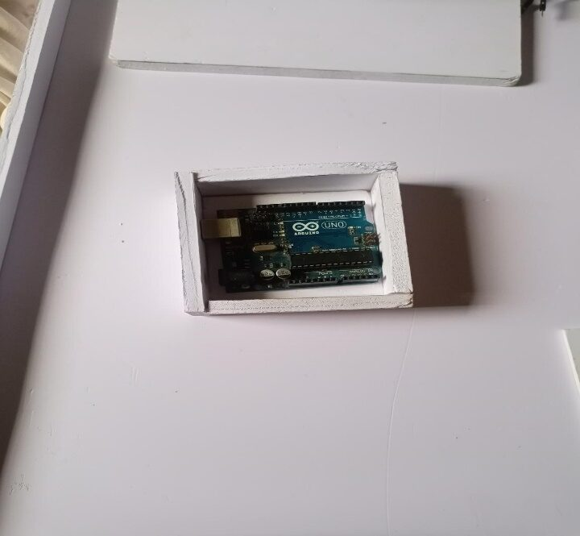
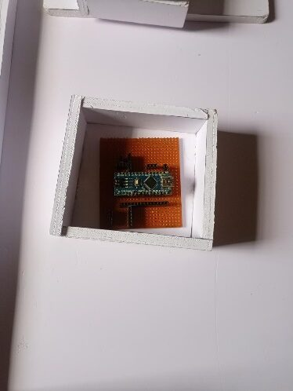
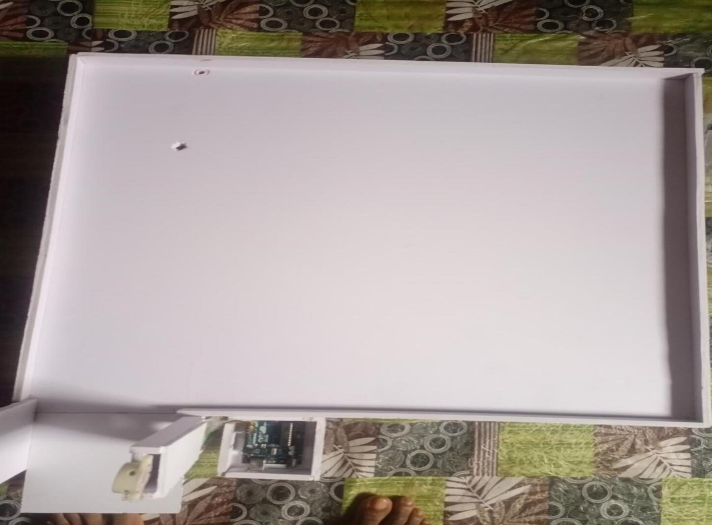
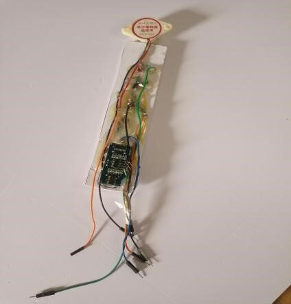
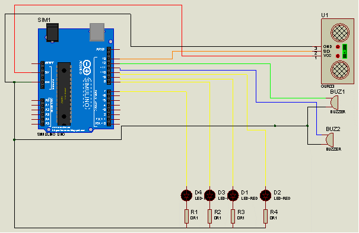
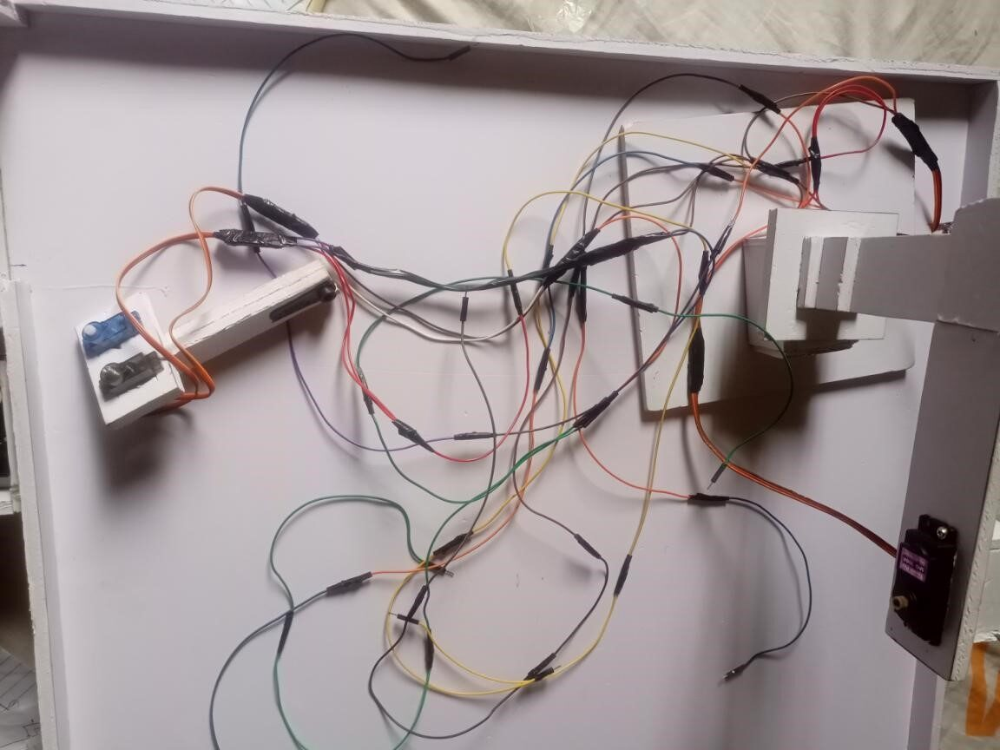

# How I built RepeatoArm

*2023–2024 · Final-year Mechatronics Engineering project, Federal University Oye-Ekiti*

This is the story of the build, organised by stage, with the pictures I took along the way. Where I did not record something, I say so instead of guessing.

[← Back to the README](../README.md)

## Where it started

   
  <em>Me building and fixing the first robotic arm, controlled by potentiometers and push buttons only</em>

The project began with a robotic arm controlled only by potentiometers and push buttons. It had no recording and no security.

RepeatoArm keeps that control scheme and adds two things: **record-and-replay** of the arm's poses, and a **separate proximity alarm**.

## The materials

   
  <em>The materials I gathered for the build</em>

The main parts are MG996R servos for the three joints, SG90 servos for the claw, Arduino boards, potentiometers, push buttons, an HC-SR04 ultrasonic sensor, LEDs, a buzzer, foam board, veroboard and chargers. The full list is in [hardware/bill_of_materials.md](../hardware/bill_of_materials.md).

## The arm

   
  <em>Servos mounted on foam board, an early stage of the arm</em>

The arm is foam board with the servos mounted directly on it. I measured the links with an engineering ruler: shoulder height 13.5 cm, upper arm 15 cm, forearm and closed claw 15 cm.

   
  <em>Assembling the arm with its control buttons</em>

## The controller and its circuit

   
  <em>A box I made for the Arduino Uno</em>

   
  <em>Circuit diagram of the robotic arm. It was drawn with a Nano; the final build used an Uno (see below).</em>

The first version of the arm's controller used an Arduino Nano. I built a veroboard with female header pins so the Nano could simply plug in. I did all the soldering on the board first, so I never had to apply heat to the Nano itself, and I brought out extra header pins for VIN, the 5 V output and ground, because the Nano has only a few of each.

   
  <em>The veroboard with the Nano plugged in, after I built the circuit</em>

## The workspace and the alarm

I built the 60 × 60 cm workspace and the alarm system before I built the arm itself.

   
  <em>The workspace and the alarm system, finished before I built the arm</em>

   
  <em>The alarm stand and ultrasonic sensor, nearly done</em>

   
  <em>Circuit diagram of the alarm. The resistor labels in the drawing are placeholders; the LEDs ran on 1 kΩ.</em>

The alarm is its own Arduino with an HC-SR04 sensor, four LEDs on 1 kΩ resistors, a buzzer and a reset button. It starts the alarm when something comes within 50 cm and clears it after 5 seconds or when the button is pressed.

## Wiring it together

   
  <em>Wiring the connections after assembly</em>

## Testing and debugging

At one stage the arm was not picking things up. I tested whether the potentiometers were driving the servos. What I changed to fix it was not recorded, so I won't claim a cause.

   
  <em>▶ Testing that the potentiometers drive the servos (the arm was not picking yet)</em>

Later I ran an all-round test, and everything worked.

   
  <em>▶ All-round test: everything working</em>

## The Nano I lost

While I was troubleshooting the arm's controller, a wire was put in the wrong hole and destroyed the Nano. I had no spare Nano, and the deadline was close. I rebuilt the arm's controller on an Arduino Uno while keeping my teammates calm.

I had planned a Nano for the arm and an Uno for the alarm. I ended with an Uno for each. The record is in [failures.md](failures.md).

## The power problem

After the circuits were built, I found a power distribution problem: the servos and the boards were competing for power. I studied it and split the loads across separate chargers, with a common ground, and added a control switch and a power switch.

I do not remember which switch controls what, and the exact split between chargers is not recorded, so I have left those open and documented them as open. They are listed in [hardware/power.md](hardware/power.md).

## The final build

   
  <em>▶ Full walkthrough: me introducing the project, a live demo and Q&A</em>

The final build used an Uno for the arm and an Uno for the alarm. In the demonstration the arm carried a 27 g PET bottle (the manufacturer's figure) from a tall tower to a short stand, about 6 cycles on video, using 8–9 saved poses.

## What I would do differently

- Check every connection before applying power, and label the wires.
- Write down the power layout while building it, not afterwards.
- Keep test notes and measurements, so every claim can point to data.
- Give the arm a hardware emergency stop and a stop button that responds during movement.
